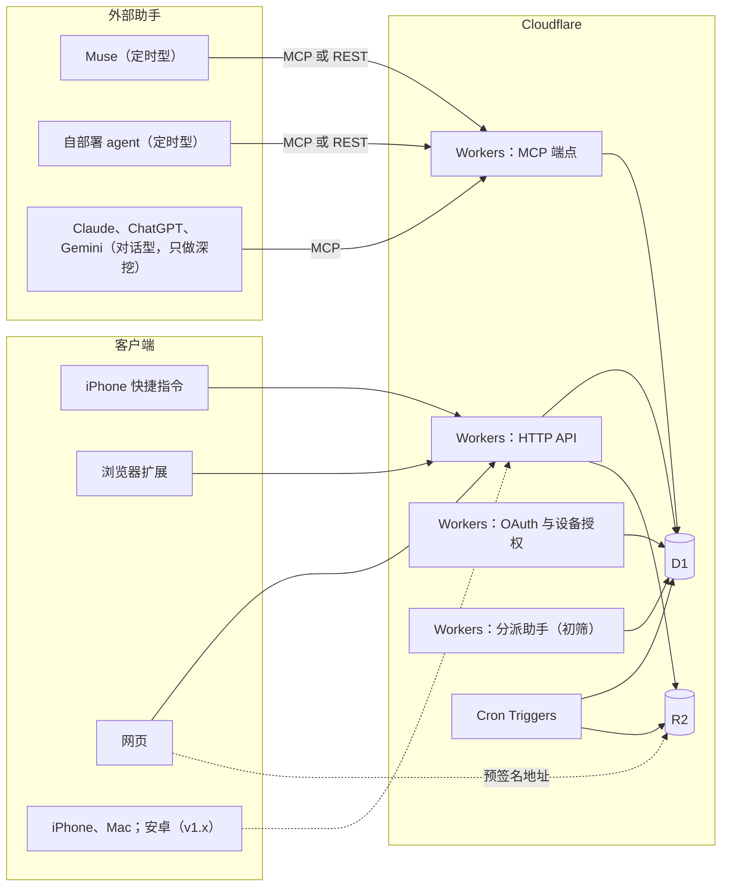

# 本产品 技术架构（Cloudflare 版）

状态：草案，2026-11-24。范围：在 Cloudflare 上搭核心和分派助手，对齐 PoC（~/all-keep）已有功能到新模型。只写架构，不写实现代码。第一期开工规格见 [techspec](techspec.md)。冲突时以 [form](form.md)、[rules](rules.md) 为准；待定项见 open #37–#53。

术语：**攒存**（采集动作：内容在一段时间里攒进来，接口动词 save，界面叫「存入」）、**条目**（用户攒存的原始内容）、**解读**（单条的 AI 分析，四项）、**每日摘要**（每天一份）、**笔记**（深挖的最终结果，可带附件）、**助手**（外部的 agent）、**初筛**（决定条目交给哪个助手、保留多久）、**过期**（到期后移入归档，用户看不见）、**归档**（过期条目的保存，长期保留，系统自行清理，不对用户展示或通知）、**认领**（助手领走一份活，有期限）。

## 1 组件图

## 2 Cloudflare 组件

| 组件 | 职责 | 理由 | 类别 |
|---|---|---|---|
| Workers | HTTP API、MCP 端点、OAuth 与设备授权、分派助手（初筛）、发通知（Web Push；v1.x 加 APNs、FCM） | 无服务器，HTTPS 自带 | 必需 |
| D1 | 条目、解读、每日摘要、深挖队列、设备、授权、配额、认领、用量、统计 | SQLite 语义，单条条件更新即可认领 | 必需 |
| R2 | 图片与附件，预签名上传下载 | 出口免费；兼容 S3 预签名 | 必需 |
| Cron Triggers | 过期归档、认领释放、摘要到期、初筛扫描、发通知、配额对账、归档清理（策略待定，#46） | 原生定时 | 必需 |
| Secrets | 模型密钥、令牌签名密钥、Web Push 密钥 | 不进仓库（E1） | 必需 |
| Durable Objects、Queues | 认领争用；攒存后解耦初筛 | D1 出现竞争时才用；v1.0 用 Cron 代替 | 按需 |

- 图片不在 Workers 编码：客户端压缩，核心只校验。
- 初筛的分派助手在 Worker 里跑，只做短调用（§10），用和外部助手相同的契约，没有后门（D1）。
- 核心抓取网页正文（8 秒超时），抓不到写「没取到内容」（#39）。

## 3 数据模型

| 表 | 要点 | 寿命与索引 |
|---|---|---|
| users | id、时区、storage_bytes、notify（on / off，缺省 on，待 open #50） | 不过期 |
| devices | id、名称、类别（client / assistant）、权限（客户端：存入、读、管理；助手：步骤）、令牌哈希、上次使用、撤销时间 | 撤销为止；(token_hash) |
| push_targets | device_id、种类（webpush / apns / fcm）、地址和密钥、登记时间 | 设备撤销、关闭通知或地址失效时删 |
| notify_batches | user_id（主键）、first_at、last_at、条目列表 | 发出即删 |
| device_codes | 短码哈希、设备名、类别、批准人、是否已用 | 10 分钟；(expires_at) |
| oauth_grants | 助手、步骤、刷新凭据哈希、撤销时间 | 撤销为止 |
| items | id、类别（link / text / image / file）、来源、url_key、标题、开头、正文或 R2 键、内容哈希、pinned、expires_at、hard_expires_at（创建后 365 天）、queue_holds、dispatch_to、expiry_days、signal、claim_id、claim_expires_at、archived_at（空为未归档） | (user_id, created_at)；(expires_at) WHERE pinned=0；(claim_expires_at)；(user_id, url_key) |
| item_tags | item_id、键（assistant / expiry / source）、值（封闭枚举）、设置者 | 跟条目；不存自由词 |
| analyses | item_id（主键）、判定（三选一）、内容概述、关键事实、要点（≤3）、关联提示、助手、认领、调用 | 跟条目；交回即替换 |
| digests | user_id + 本地日期（主键）、四部分（JSON）、助手、due_at、read_at | 不过期 |
| deep_read_queue | id、item_id、状态（queued / reading / read）、精读助手、认领、最后动静 | 7 天无动静移出 |
| deep_dive_requests | id、item_id、助手、开场话、最后动静 | 7 天无动静删除 |
| notes | id、标题、正文、出处、助手、提交方（assistant / user）、调用 | 不过期 |
| assets | id、user_id、sha256、R2 键、字节数、类型、引用数、状态 | 引用为零时删；唯一 (user_id, sha256) |
| claims | id、助手、类别（triage / analysis / digest / deep_read）、条目列表、期限、状态 | 过期后 30 天清理 |
| usage_records | 助手、调用、认领、类别、模型、输入与输出 token、条目数、是否自报 | 不过期，只存数字 |
| daily_counts | user_id、日期、来源、攒存、解读、摘要、笔记数 | 不过期；归档的条目照常计数 |
| idempotency | user_id + 键哈希、应答 | 7 天 |

## 4 API 清单

`/v1` 前缀。分页用游标，limit 缺省 20、最多 100。调用不等待模型。

**客户端**的接口清单（权限：存入、读、管理）在 [techspec](techspec.md) §3，与本节同源。

**助手**（REST 与 MCP 工具一一对应）

| REST | MCP 工具 | 用途 |
|---|---|---|
| GET /assistant/work | 无（普通 HTTP） | 有没有活：各类别待办数与最早期限 |
| POST /assistant/claims | claim_work | 认领（类别、数量 ≤10） |
| POST /assistant/claims/{id}/renew | renew_claim | 续期（仅持有者） |
| DELETE /assistant/claims/{id} | release_claim | 放回 |
| GET /assistant/rules?kind= | get_rules | 规则与相关设置 |
| GET /assistant/items/{id}/context?for= | get_context | 只读上下文 |
| POST /assistant/claims/{id}/submit | submit_result | 交回（标签、解读、每日摘要、精读报告、笔记）并附用量 |
| GET /assistant/deep-dive-candidates | list_deep_dive_candidates | 对话型助手：可深挖的条目（只读） |
| POST /assistant/deep-dive-requests | register_deep_dive | 对话型助手：登记深挖 |
| POST /assistant/notes | save_note | 对话型助手：存回笔记（须用户明确要求） |

超出授权步骤返回 403。分派助手只用 claim_work（triage）和 submit_result（只含标签）。

## 5 认领

- 条件更新：claim_id 为空或已过期才写入。一次最多 10 条，同一条同时只归一只助手（D4）。
- 期限缺省 30 分钟（#37）。续期只允许持有者。
- 交回幂等：同一认领、同一条、同一类别，重复交回返回第一次的结果。认领过期后交回仍被接受；另一认领的新交回替换旧的，每条每类只留一份。
- 署名：analyses、digests、notes 记助手、认领、调用。撤销助手时，同一事务释放其认领。

## 6 过期与定时

Cron 每小时；初筛与通知每分钟。

- **条目过期**：pinned=0，且 expires_at 已到且 queue_holds=0，或 hard_expires_at 已到，则设 archived_at。归档的条目不出现在任何列表、查询、搜索、每日摘要或初筛里，界面不显示，也不通知用户。归档保留全部数据（条目、解读、标签、附件）；R2 对象不删。
- **归档清理**：由系统按内部策略执行。缺省是长期保留，清理策略待定（open #46）。清理前不展示、不通知。
- **保留只推迟到期**：深挖队列中的条目 queue_holds>0 暂不归档；hard_expires_at 不变，过期前总寿命不超过一年。
- **深挖与上传**：7 天无动静按 §3 移出或删除；认领过期清空 claim_id；上传未完成超过 1 小时删记录与对象。
- **每日摘要**：用户本地 21:00 之后，当天有条目且无摘要，设 due_at；GET /assistant/work 出现「每日摘要」类活。漏掉的日子并入下一份。
- **通知**：解读或精读交回时记进该用户的待发批次；初筛交回不记。每分钟检查：最后一次交回已过 2 分钟，或第一次已过 10 分钟，就发一条。发之前去掉已处理和 notify 排除的条目，一条不剩就不发。只发给读档、管理档的设备；发送失败重试一次；地址失效删 push_targets。
- **初筛**：每分钟取待初筛条目（≤10）交分派助手；超过 10 分钟未初筛，核心补缺省（缺省助手，expiry_days 30）。初筛完成不发通知（规则 A16）。

## 7 存储与配额

- **入口**：客户端压缩为长边 1600 px 的 WebP。服务端拒收超过 3 MB 或文件头不符的文件。
- **去重**：客户端先算 SHA-256 询问，已有则复用。R2 键 `u/{user_id}/{sha256}`，按引用数计数。**预签名**：PUT 10 分钟，锁定字节数与类型；GET 5 分钟。
- **配额**：缺省每用户 1 GB（#41）。超额时攒存照常成功、文字保留，图片不存，应答写明「图片没存入：超出存储配额」（B2）。storage_bytes 同事务更新，每日对账。

## 8 迁移视角（映射待定 #43）

| PoC | 新模型 | 处理 |
|---|---|---|
| bookmarks、links、texts | items | archived、favourited、decision 转为 pinned 与 signal；remind_at、hidden 丢弃 |
| assets、bookmark_assets、tags、tags_on_bookmarks | assets、item_tags | 重算 SHA-256；标签只留 assistant、expiry、source |
| note 中的 🧠 摘要 | analyses 或 digests | 待定，默认不映射 |
| feedback、webhooks、deliveries、capture_keys、waitlist、fts | 丢弃 | 信号口径不同；不做对外 webhook（A1）；关键词查询改做，见 [techspec](techspec.md) §5 |
| users | users | 只迁 owner |
| sessions、api_tokens、pairings、device_codes | 不迁 | 设备重新授权 |

PoC 的 API 权限（save、readonly、full）映射待定。

## 9 运行与成本

价格以撰写时官方页为准，实施前核实。生产用付费档：Workers、D1 起步各约每月 5 美元；R2 超出约 0.015 美元/GB·月。

估算（50 人、每人每天 100 条、按 30 天存量）。归档长期保留，实际占用随时间累加，需按累计重算（#46）：
- **D1**：文字约 15 万条 × 3 KB ≈ 0.5 GB。
- **R2**：20% 条目带约 300 KB 图，约 9 GB，约 0.14 美元/月；最坏每条 3 MB，约 450 GB，约 7 美元/月。
- **初筛**（最大变动项）：每条约 1500 输入 token，5000 条/天约 2.25 亿 token/月，约 225 × P 美元（P 为每百万 token 价）；最坏为 450 × P。

## 10 风险与待定

- **Workers 时间**：初筛的模型调用限 10 秒墙钟，超时走缺省；不在用户请求路径上。
- **D1**：单库、单写入者，50 人远低于上限。转 Postgres 的条件：接近 5 GB 或写入排队。
- **认证**：助手持有长期刷新凭据（不过期、每次轮换、可撤销），换取 1 小时的访问凭据。撤销即时，每次请求查 D1。设备令牌空闲 90 天失效（#42）。
- **公网安全**：只走 HTTPS；限流；攒存与交回用 Idempotency-Key；预签名锁定大小与类型；抓网页禁止跳到非公网地址。
- **用量自报**：助手自报 token，核心无法核验，只用于统计；计费前必须核对。
- **归档与隐私**：用户看不见归档，数据仍在，R2 对象未删。对外保留说明须写明（服务条款或隐私说明），否则与对外的「删除」口径不一致（#46）。
- **通知**：Web Push 正文在核心加密；APNs、FCM（v1.x）正文经过 Apple、Google，含条目标题。iPhone 网页须先加到主屏幕。
- **密钥**：模型密钥放 Workers Secret，不进仓库、不进聊天（E1）。
- **待定**：#37 认领期限、#38 服务端图片变换、#39 网页抓取由谁做、#40 初筛成本上限、#41 存储配额、#42 令牌有效期、#43 PoC 映射、#44 统计页、#45 通知、#46 归档清理、#47 对外保留说明、#53 v1.0 通知可见性。
