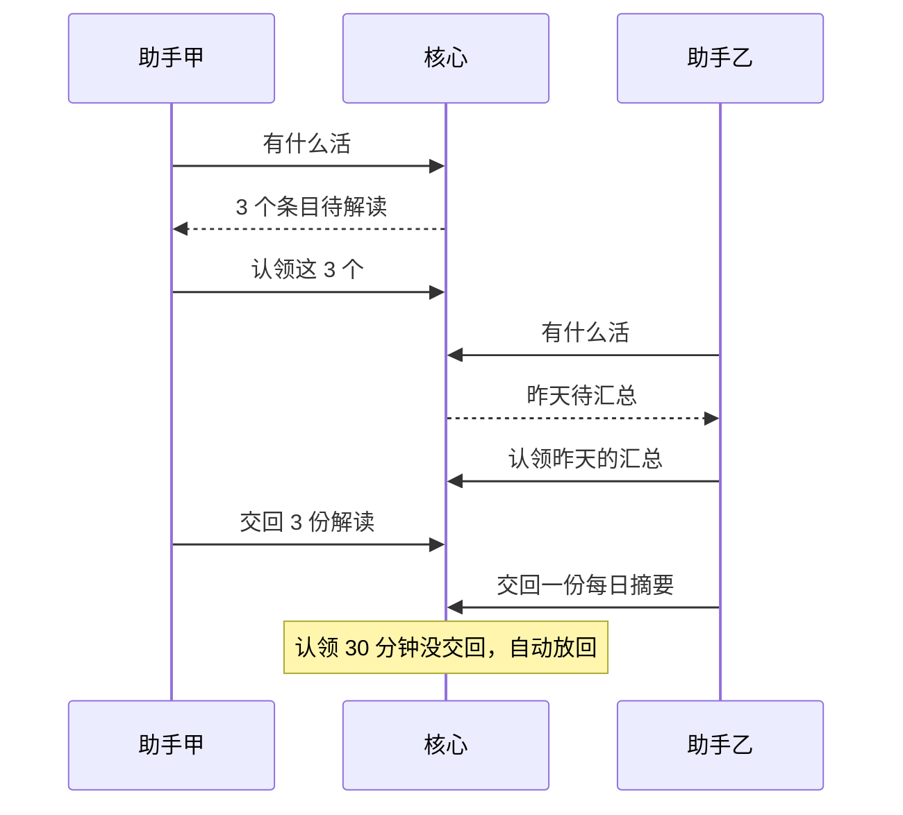
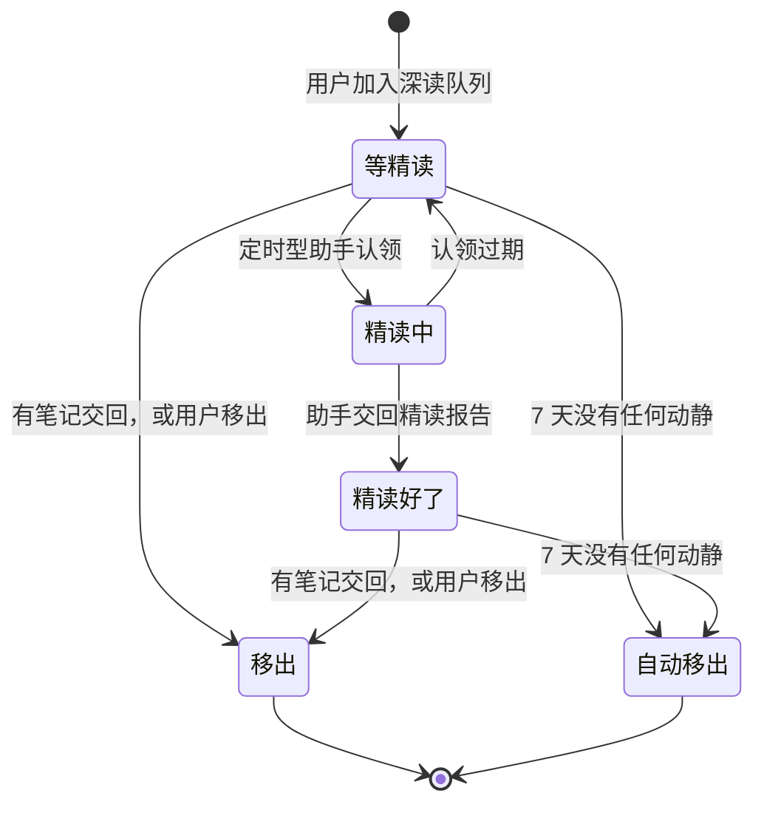

# 助手

助手是接入的 agent。核心不替助手干活，没有助手也不出错。

## 种类

| 助手 | 谁提供 | 做什么 | 收费 | v1.0 |
|---|---|---|---|---|
| 分派助手（Scout） | 我们 | 初筛 | 免费 | 有 |
| 自带助手 | 用户 | 解读、汇总、深入对话 | 免费 | 有；是唯一做解读的助手 |
| 工作助手 | 我们 | 解读、汇总；不做深入对话 | 收费 | 不做 |

- 每只助手有用户起的名字，在一个用户内唯一。规则、标签、署名都用这个名字。
- 契约里没有工种。一只助手可以做一步，也可以做几步。

自带助手按能力分两类，不按品牌分：

| 类 | 是什么 | 能做 | 例子 |
|---|---|---|---|
| 定时型 | 能不用人叫、按时间表自己运行的 agent | 解读、汇总、深入对话；精读只由它做 | Muse、自己部署的 agent |
| 对话型 | 只在用户和它聊天时干活的聊天助手 | 只有深入对话 | Claude、ChatGPT、Gemini |

哪一类在接入时定。对话型助手不能选作解读助手和汇总助手。

## 助手设置

用户在「助手设置」里维护，存在核心：

| 设置 | 内容 | 缺省 |
|---|---|---|
| 助手清单 | 接入了哪几只助手，各自的名字和干哪几步 | 空 |
| 缺省解读助手 | 标签没指名时由谁解读 | 无 |
| 汇总助手 | 由谁出每日摘要 | 无 |
| 精读助手 | 深读队列里的条目由谁精读。只能是定时型助手 | 无 |
| 缺省深入对话助手 | 在产品里点「深入对话」时缺省找谁 | 无 |
| 寿命档位 | 条目可选的寿命，天数 | 7、30、90、365 |
| 规则 | 用户写给分派助手的一段话：什么样的条目交给谁、保留多久 | 空 |

「无」的那一步没人做。

## 标签

只在条目上。写成 `种类:值`。界面上不显示；只在条目的详情和设置里能看到。

| 种类 | 值 | 谁写 | 作用 |
|---|---|---|---|
| `assistant` | 助手清单里的一个名字 | 分派助手；用户可改 | 这个条目由谁解读 |
| `expiry` | 寿命档位里的一个天数 | 分派助手；用户可改 | 这个条目保留多久 |
| `source` | 设备和入口的标识 | 核心 | 只用于统计 |

- 值是封闭的：只能取清单里有的。不设描述内容的标签。
- 用户改过的标签优先，分派助手不覆盖。
- 新增种类不需要改核心的处理逻辑：核心只认识 `assistant`、`expiry`、`source`，其余原样保存。

## 初筛

1. 条目攒存进来，进入待初筛。
2. 分派助手取走，读条目的标题、来源、开头（不读全文），加上用户的规则和两份清单，输出 `assistant` 和 `expiry`。
3. 分派助手没给出的，核心补缺省：`assistant` 取缺省解读助手，`expiry` 取 30 天。
4. 初筛完成后，这个条目才出现在别的助手的活里。

- 分派助手用便宜、快的模型。每个用户每天最多初筛 200 条；超出的由核心直接补缺省。初筛不发通知。
- 分派助手没在运行时，核心在条目等了 10 分钟后直接补缺省。

## 解读的格式

做解读的助手必须按 [form](form.md#解读) 的四项交回，核心按字段收，不收自由格式：

| 字段 | 要求 |
|---|---|
| 内容概述 | 一句话，不超过 60 字 |
| 关键事实 | 一行，按条目的类型填 |
| 要点 | 0 到 3 条，每条一句 |
| 判定 | `值得深读`、`了解即可`、`可跳过` 之一 |
| 关联提示 | 可选，一句话，指明和以前的哪一条有关联 |

- 条目没取到内容时，助手交回「没取到内容」，不写要点和判定。
- 关联提示只由做解读的助手给。分派助手不给。

## 取活和交回

契约给助手五样能力，此外什么都不能做（[rules](rules.md) D7）：

| 能力 | 说明 |
|---|---|
| 问有什么活 | 只返回该这只助手做的。分四类：待初筛、待解读、待汇总、待精读的条目。没有活时返回空，可用普通 HTTP 请求问，不经 MCP 和模型 |
| 认领 | 领走一份或一批。30 分钟没交回自动放回。可以主动放回 |
| 取规则 | 这个用户的规则和助手设置里与这一步有关的部分 |
| 取上下文 | 解读：这个条目，以及可对照的未删除的条目和解读、每日摘要、笔记。汇总：当天及此前漏汇总的解读，连同用户对每条解读的标记（不感兴趣、看过了、已加入深读队列）。精读：队列里的那一条。深入对话：队列里的那一条或每日摘要里的那一条（连同它的精读报告），相关的每日摘要、笔记、未删除的条目和解读。助手可以在每日摘要和笔记里按文字查找 |
| 交回 | 解读（可附关联提示）、每日摘要、笔记（可带附件）、分派助手的标签、精读报告。带署名。重复交回同一份，后一次替换前一次，不产生第二份 |

- 活归谁：待解读的条目归它 `assistant` 标签指的助手；待汇总归汇总助手；待精读的条目归它指定的精读助手。
- 助手多久来一次都必须正确：一小时一次、三天一次、两只同时来，结果一样。
- 解读交回后，核心[通知](form.md#通知)用户。这是核心的事，助手不用管，也不能替用户发。
- 提醒：助手可以登记一个接收地址。有它的新活时核心向该地址发一个不带内容的请求。
- 助手在每日摘要和笔记里的查找只是干活用的上下文，不在读的平台上暴露。

## 没有助手时

- 条目照样能攒存，照样按寿命过期；已有的每日摘要和笔记不受影响。
- 读的平台必须显示：多少个条目还没被解读、最早的一个哪天删除、每只助手上一次来的时间、今天为什么没有每日摘要。
- v1.0 不发提醒。

## 精读与深入对话

读的深度有三层，一层一个词：

| 层 | 谁做 | 做什么 | 产出 |
|---|---|---|---|
| 解读（自动） | 助手，自动，每个条目都做 | 读一遍，写四项 | 解读 |
| 精读 | 一只定时型助手，自己做，用户不在场 | 把深读队列里的一条读透，去查相关的 | 一份精读报告：读出来的、另外查到的、可以接着问的。跟着队列里的那一条走，不是笔记 |
| 深入对话 | 用户，带着这一条去助手那边 | 对话；让助手再去查（deep search）；执行助手那边预定的操作（跑脚本等） | 用户说了才交回笔记；也可以什么都不交回 |

深读队列是用户计划深入讨论的条目清单。加入的条目，精读助手下次来取活时精读；用户有空了再去深入对话。没加入队列、没精读也可以直接去深入对话。

**核心看不到助手那边发生了什么。** 用户开了一场深入对话，不等于对话真的做了什么，更看不出它什么时候结束。所以队列里的一条没有「深入中」「已完成」这类状态。核心只认它自己能看到的事：

| 看得到的事 | 怎么记 |
|---|---|
| 用户把一条加入队列 | 时间 |
| 精读助手认领、交回精读报告 | 状态：等精读、精读中、精读好了 |
| 用户在产品里点了「开始深入对话」 | 时间。只说明他去了 |
| 助手为这一条取过上下文 | 时间。只说明助手来取过 |
| 助手为这一条交回了笔记 | 笔记；这一条移出队列 |

- 对话型助手只能深入对话，不能精读。精读要无人值守，只有定时型助手能做。
- 精读和深入对话可以是两只不同的助手：精读挂在队列里的那一条上，深入对话的助手取上下文时一并拿到。
- 一条移出队列有三种：有笔记交回、用户自己移出、7 天没有任何动静。移出不妨碍以后再深入对话、再交回笔记。
- 助手在深入对话里查什么、跑什么，是助手那边的事。核心不发起、不记录，也不保证它做得到。

两种发起方式都支持：

| | 从助手那边 | 从产品这边 |
|---|---|---|
| 用户做什么 | 去找助手，说要深入哪一条 | 在一份解读或每日摘要的某一条上点「深入对话」，选加入队列先精读，或现在去深入对话。手机上往右滑等于加入队列 |
| 交给谁 | 用户找的那只助手 | 精读交给精读助手；去深入对话找缺省深入对话助手，点的时候可以换 |
| 对话型助手（只能深入对话） | 列出最近的条目或按文字找到那一条，取上下文，登记一次深入对话，开始聊 | 核心立刻给出入口：能用链接开场的产品，打开一场新对话并填好开场话；不能的，显示一句可复制的开场话和「打开它」。用户发出开场话，助手凭其中的条目名取上下文、登记 |
| 定时型助手 | 同上 | 精读：来取活时领走队列里的条目，取上下文，读完交回一份精读报告。要等它下一次来 |

- 开场话是固定的一句加那一条的第一行。它不含内容，内容由助手经 MCP 取。
- 去深入对话找的是定时型助手时，入口是它交回精读报告时附的一段文字，通常是一个链接。核心原样转交；不是链接就显示成文字。
- 状态图里只有精读的状态。用户去没去深入对话不是状态，见上表。
- 精读报告不算笔记。它跟着队列里的那一条走：这一条移出队列，精读报告一起没有；想留下就在深入对话时存成笔记。
- 助手只在用户于对话里明确要求时登记深入对话，不自己发起。
- 交回笔记有两条路，产物相同：
  - 助手存回：用户在对话里明确说出（如「存成笔记」）之后，助手才交回。助手不自己决定存。
  - 用户贴回：助手所在的产品不允许它写时，用户把结果贴进队列里的这一条，存成笔记。署名仍是那只助手，另记「由用户交回」。
- 一条在深读队列里期间，相关的条目和解读被保留；移出队列时解除。
- 一次深入对话可以交回多份笔记。

### 给对话型助手的东西

| 能力 | 说明 |
|---|---|
| 列出可深入对话的 | 最近的每日摘要里「值得深读的」各条、今天的解读、深读队列里的条目。只读 |
| 取一条的上下文 | 同「取活和交回」里的取上下文（深入对话）。只读 |
| 登记深入对话 | 开始一次，或接上产品里发起的那一次 |
| 存回笔记 | 标题、正文、出处、可选附件 |
| 服务器说明 | 给助手看的一段话：深入对话是对话，不要自己写完；用户说了才存；写全结论和出处。前 500 字自成一段 |

- 只读的工具标明只读，助手不逐次问用户；存回笔记是写入，助手会按自己的规矩让用户确认。

## 接入和认证

- 助手连接核心公网地址上的 MCP 端点（Streamable HTTP）。这个接入地址所有用户相同，不是凭据。
- 助手经标准的 OAuth 授权接入：用户在助手那边填入接入地址，助手打开 本产品 的允许页，用户登录后点「允许」。核心是授权服务器：授权码加 PKCE，支持 CIMD 和动态注册，助手不需要事先登记。
- 允许页写明：谁想接入、它要干哪几步、内容会被送到这只助手运行的地方。用户在这一页给助手起名字、勾掉不让它干的步骤。对话型助手只有「深入对话」可选。
- 授权后助手持有可自动续期的凭据：不需要用户经手，不需要定期重新授权，只能做助手的能力，只能看到这个用户的数据。
- 助手的权限是「干哪几步」，不用客户端的三档。助手不能读用户的界面，不能管理设备。
- 助手是一种设备：在「设备」页和助手设置页都能撤销。撤销立即生效，它认领中的活放回。
- 不提供固定凭据（API key、Bearer token）这条路。
- 分派助手用同一套契约，只有初筛的权限；它由我们提供，不需要用户授权，不占设备列表。
- 各产品的接入步骤见 [connect](connect.md)。

## v1.0 不做，契约里留位置

| 项 | 留什么 |
|---|---|
| 偏好说明 | 信号已经在记：深入对话是正向，不感兴趣是负向，看过了和沉默不算。助手设置里留一个只读的 `preference` 字段，取规则时一并返回 |
| 统计页 | `source` 标签和每日计数由核心累计；条目删除后只留汇总数字 |
