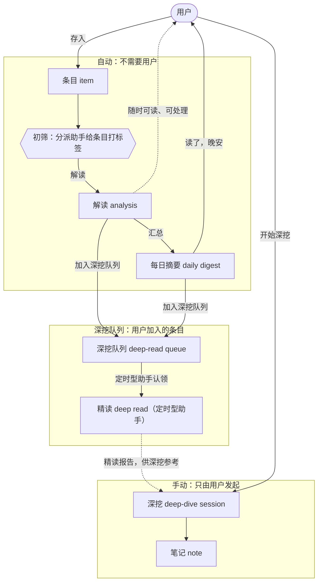

# 产品形态

**AI根据你的需求，帮你筛选，为你内化。**

对外的口号是「阅尽千芳，只留精华。」。对外文案不用「内化」这个词，说「深挖」和「留下」；这里的「内化」只是内部对手动那一段的叫法。

- **根据你的需求**：你定的规则，加上你用行为给出的信号（深挖过什么、标了不感兴趣的）。
- **筛选**：自动的那一段。攒存的条目由分派助手初筛，由助手逐条解读，汇成每天的每日摘要。
- **内化**：手动的那一段。你对值得的条目和 AI 深挖，产出留下来的笔记。

一切设计从这句话出发。

## 是什么

用户在任何设备上一个动作把内容存入。筛选的产物是解读（每条一份，随时可读、可处理）和每日摘要（每天一份）；内化的产物是笔记。

## 不是什么

- 不是记事本，不是知识库。
- 不提供按条件过滤、分类、翻找旧内容的功能。条目、解读和每日摘要没有搜索；只有留下来的笔记可以快速查找，见[笔记](#笔记)。
- 不要求用户整理任何东西。
- 不替用户内化：助手可以先替用户精读，但留不留、留什么，只在用户亲自深挖时定。

## 流程

| 步骤 | 谁做 | 输入 | 产出 |
|---|---|---|---|
| 攒存 | 用户，经客户端 | 网页、文字、图片、截屏、文件 | 条目 |
| 初筛 | 分派助手 | 条目的标题、来源、开头 | 条目上的标签 |
| 解读 | 助手 | 一个条目 | 一份解读；可附一条关联提示 |
| 每日摘要 | 助手 | 当天的解读 | 一份每日摘要 |
| 精读 | 定时型助手 | 深挖队列中的一条 | 一份精读报告；不算笔记 |
| 深挖 | 用户和助手 | 一份解读或每日摘要里的一条，加相关上下文 | 笔记；也可以没有 |

每一步发生在助手来取活的时候，不是用户存入的那一刻。细节见 [助手](assistants.md)。

## 一个条目的样子

所有类型的条目（文章、视频、截屏、代码仓库、社交帖子、纯文字、文件）用同一套结构。类型的差别只有一个小图标和解读里的一行关键事实。

| 阶段 | 显示什么 |
|---|---|
| 刚存入 | 类型图标、标题（没有就取正文第一句）、来源站点名、存入的时间。不显示链接串和正文残片。没取到内容就写「没取到内容」。在读视频里的话的，写一句「正在读视频里的话，读好了会接着解读。」 |
| 初筛后 | 同一张卡，多一行小字：交给哪个助手、还剩几天 |
| 解读后 | 解读，见下。核心同时发一句[通知](#通知) |
| 进每日摘要 | 值得深挖的：一句话加判定。其余的：一行标题 |
| 删除 | 条目和解读消失；每日摘要里那一句还在 |

## 视频

条目里有视频的（小红书的视频笔记、B 站和微博的视频、公众号文章里内嵌的腾讯视频），除了页面上的文字，还读视频里说的话。

- **先存入，后读。** 存入照常立刻答「已存入」。条目页上写「正在读视频里的话，读好了会接着解读。」这一条先不解读，等视频读好或放弃再解读；这时用户已经能看到作者自己的话和原文链接。最多等 60 分钟（`video_wait_minutes`），到了就放弃，按没读到处理。
- **读到的话单独成块。** 条目页「原文」里，先是作者自己的话（说明、页面正文），下面是「识别出来的文字」一块，块下一行淡字：「从视频的声音识别出来的，可能有错字。」识别出来的文字不是作者写的，也不当引文。列表、卡片、[每日摘要](#每日摘要)、通知都不带它。
- **正文和视频分开算。** 正文可用、视频没读成：正文照常可用，解读照常做，条目页另说一句视频的事（「视频里没有识别出话语。」「视频太长（超过 15 分钟），没读。」「视频里的话没取到。」）。不因为视频没读成就把整条标成「没取到内容」，也不把没读到的视频当成读过。正文很短、视频也没读成的，才是「没取到内容」。正文很长又带视频的，两样都读。
- **识别不出话语。** 只有音乐、烧录在画面上的字幕、没有人声时，写「视频里没有识别出话语。」，不输出猜出来的字。画面上的字不读。
- **上限。** 视频最长 15 分钟（`video_max_minutes`），超了不下载，写「太长」。一次只识别一条（一条在识别，另外最多四条排队等着，一共五条）；第六条起排不上，立刻照实写「没取到」，不无限等；前面有一条做完，就又能接新的。
- **读不了的。** 视频号（要临时凭据，文件加密）和要登录才能看的视频，照实写「视频里的话没取到」；不绕过登录，不用别人的账号。
- **给助手的。** 识别出来的文字单独交给助手（`recognized_text`），说明里写：从声音识别出来的，可能有错；说「视频里说……」，不把里面的人名、数字当事实。解读的四项不变，关键事实写视频时长。
- **保留和删除。** 识别出来的文字跟条目走：条目过期、删除、账户删除时一起没了。这时还在读的任务作废，迟到的结果丢弃，不写回；视频和音频文件读完就删，不留；不记网址，不记账户。同一条目只读一次，重复的结果不会重复解读。

## 解读

解读一交回就出现在读的平台的「今天」里，用户不必等每日摘要；核心同时[通知](#通知)用户。固定四项，顺序不变：

| 项 | 内容 |
|---|---|
| 1 内容概述 | 一句话 |
| 2 关键事实 | 一行，随类型变：文章是作者和篇幅，视频是时长，仓库是语言和星数，截屏是图里的要点，帖子是作者和平台，文字是字数，文件是格式和页数 |
| 3 要点 | 最多三条 |
| 4 判定 | 三选一：值得深挖、知道就行、可以略过 |

四项下面是关联提示（有才显示）和三个动作：深挖、不感兴趣、看过了。原文链接收在卡片角上。没取到内容的条目，解读只有第 1 项「没取到内容」和原文链接，不凑要点。只读到页面外壳的（几个导航词、验证页）也算没取到：留下标题，那几个词不当内容解读。条目页上在「没取到内容」下面说一句能怎么办：在那边把正文复制下来当文字存入，或者存一张截图。

### 写成什么语言

Cheney 2026-11-26 定（internal-qa #18，选 2）。

- **缺省跟着条目本身的语言写。** 条目自己的字（标题、正文）是中文的，解读写中文；是拉丁字母写的（英文或别的拉丁字母语言），解读写条目用的那种语言，不翻成账户的语言。解读的四项、关联提示用同一种语言。
- **看不出来时用账户的语言：** 条目没有字可读（图片、没读出文字的文件），字太少判断不了（几个字、名字、缩写、一个数字），或者是别的文字（日文、韩文、俄文……）。账户的语言就是界面的语言（`lang`）。
- **账户里有一个开关「总用我的语言」，缺省关。** 打开后，所有新写的解读和每日摘要都用账户的语言，不管条目是什么语言；助手要翻译着写，不照条目的语言。
- **只管新写的。** 已经写好的解读和每日摘要不重写、不翻译；改开关、改账户的语言都不动它们。
- **语言不对就重问一次。** 助手交回的解读里有一项不是应该写的语言，核心请助手重写一次，次数和等待时间有上限；重写的答复更好才换掉第一份，否则第一份留下，不因此把条目判成读不出来。
- **判断只看字形，不是语言识别。** 汉字、拉丁字母、别的文字，三类；法文和英文同属拉丁字母，核心分不出来，由助手照条目自己的语言写。核心只查「是不是写成了另一类文字」。

## 寿命

| 东西 | 寿命 | 到期 |
|---|---|---|
| 条目 | 缺省 30 天，从存入算；用户可按条目改，最长一年。用户收藏的不过期 | 删除（用户看不见；归档副本的保留规则见 数据保留说明（尚未发布）） |
| 解读 | 跟它的条目 | 随条目删除 |
| 标签 | 跟它的条目 | 随条目删除 |
| 每日摘要 | 不过期 | — |
| 笔记 | 不过期 | — |

- 寿命和上限由核心执行，不依赖任何助手。设的值超过上限按上限算。
- 存入的条目缺省是临时的：到期就删。
- 收藏就是延期：用户把一个条目的寿命延到不过期。条目和它的解读原样留下，不需要精读或深挖。收藏的条目还是条目，不是笔记；可以随时改回有期限。只有用户能收藏，助手和分派助手不能。
- 条目到期时没被解读，照样删除。
- 一条在深挖队列里期间，相关的条目和解读保留不删，直到它移出队列；保留也不超过一年上限。
- 同一个网址在条目删除后再存入，是一个新条目。

## 读的界面

四个入口，顺序固定，手机底栏、安卓底栏、网页左栏完全一致：

| 入口 | 内容 |
|---|---|
| 今天 | 缺省进来就是它：已经存入、还没进每日摘要的东西。上面是状态栏；下面是解读，新的在前，每个带三个动作；还没被解读的条目排在后面，样子更轻。全部处理完时只写一句话；背景是[月历](#月历) |
| 每日摘要 | 打开直接是最新一份，未读时入口上有一个点；可以翻以前的 |
| 笔记 | 最上面是快速查找，然后是深挖队列，再是笔记列表；底部是当月的[月历](#月历) |
| 助手设置 | 助手、规则、设备、我的月历、账户（界面语言和「总用我的语言」开关）。只有管理档的设备有这个入口 |

没有「首页」和「设置」。条目不是单独的入口，它在今天里；深挖队列在笔记里。

## 开始用和反馈

- **开始用**：一页讲清一天怎么过（存入、等解读、按一下处理、晚上读每日摘要、深挖的结果留成笔记）和存入的几种办法（网页上的框、安卓的分享菜单、iPhone、浏览器扩展），每种办法只写现在真的能用的做法。从没存入过任何东西的账户，「今天」上显示的就是这一页的内容，不是一句「今天还没有存入」；存入第一条之后它让位给条目。之后随时可以从账户入口旁边的「开始用」再打开。
- **反馈**：应用里的一张表（在哪个端、当时在做什么、哪里不对劲、希望它怎样），直接发给运营这个服务的人，连同账户的邮箱，方便回复。反馈不是条目：不解读、不给助手看、不进每日摘要、不进导出。运营者在管理后台里读；配了转发时每条同时建成跟踪用的仓库里的一个 issue。每个账户每天最多 20 条。

## 月历

月历是一个月的图：一天一个圆点，按日期每行七个排开，当月几天就几个圆点。它表现这个人这个月存入了多少、产出了多少笔记。界面上就叫「月历」；画法见 `brand/visual.md`（品牌资料暂未公开）。

| 圆点上的标记 | 这一天 |
|---|---|
| 很小的灰点（空） | 什么都没存入 |
| 灰色空心圈（描边） | 存入了条目，还没有每日摘要 |
| 黑色空心圈（半满） | 有每日摘要，还没读 |
| 黑色实心点（满） | 每日摘要读了 |
| 金色实心点 | 当天产出了笔记 |

- 今天那个圆点外面套一个细线方框。未来的日子也画：是中性的灰点，点不了，不带任何标记。当月几天就几个圆点，不管今天是几号。
- 位置有两处：「今天」页顶部的背景，偏右上，淡，不挡文字，状态栏叠在上面；「笔记」页底部一张当月的月历卡片，下面带那行数字。别的页面不放。
- 点开是当月的大月历，下面一行数字：存入了几条、出了几份每日摘要、读了几份、产出了几份笔记。可以翻以前的月份。点一天打开那天的每日摘要；那天没有每日摘要就不可点。
- 它只记那天发生过什么：条目删除后圆点不变。不显示条目的标题，不能从这里翻到条目。
- 没有连续天数，没有断签提示，没有红色，不发提醒，不和别人比。没东西的日子只是一个很小的灰点。
- 页面没有东西可列时只写一句话，不另画插图。

### 月历的图片地址

用户可以给自己的月历开一个图片地址，贴到个人主页、文档、桌面小组件、别的应用的背景里。

- 缺省关闭。打开后得到一个猜不到的地址；可以随时换一个（旧的立刻失效）或关闭。
- 不登录就能看。每次请求得到的都是当前的月历。
- 图里只有圆点和标记，没有标题、来源、文字、用户名；角上可以带一个小的 本产品的标志。
- 样子用地址上的参数选：浅色、深色、透明底；这个月，或最近十二个月（十二个小月历排成一排）；带不带底下那行数字。
- 格式是 SVG，另给 PNG。
- 它是只读的图，不是接口：不走授权流程，不算设备。
- 在「助手设置」里的「我的月历」管理。管理档能开关、换地址、选样子；读档只能看图，看不到地址。

## 每日摘要

- 每个用户每天至多一份，缺省在用户时区 21:00 之后由汇总的助手产出。
- 当天没有解读就不出。漏了一天的解读并进下一份，不补发。
- 纯文字，不嵌图片。图片内容用文字描述。
- 不含大段原文。每条写够结论，出处只留原始网址和标题。
- 不带标签。
- 写成什么语言：缺省用当天多数解读所用的语言；两种一样多，或一份解读都判断不了，用账户的语言。打开「总用我的语言」时，一律用账户的语言。见[解读](#写成什么语言)。

固定四部分，按这个顺序：

| 部分 | 内容 | 视觉 |
|---|---|---|
| 总结 | 几句话说今天存入了什么。里面写到条数的话，必须等于这份每日摘要实际汇总的条数（页眉和下面几部分列出的那些）；拿不准就不写数目。数目由快照定，不由写总结的助手猜 | 不抢眼 |
| 值得深挖的 | 判定为「值得深挖」且用户还没处理的条目。每条一张卡：一句话、判定，带深挖、不感兴趣、看过了 | 重点 |
| 其余的 | 当天别的条目，以及用户已标不感兴趣或看过了的。每条一行标题。任何一条可以挽回到上一部分 | 折叠，不显眼 |
| 睡前一问 | 一个问题，让用户带着想法入睡。不要求回答 | 收尾 |

末尾一个按钮「读了，晚安」，按下即标这份每日摘要读了。

## 笔记

- 深挖的最终产出：一篇 artifact，可查看、可下载，也可以把它分享给别人。
- 快速查找：笔记页最上面一个输入框，输入几个字，按标题和正文找笔记。只找笔记，不找条目、解读和每日摘要。做法见 [techspec](techspec.md) §5。
- 可以带附件。想长期保存的原件（例如原图）只有这一条路。
- 自己站得住：结论写全，出处只留原始网址和标题，记下它出自哪份每日摘要的哪一条。
- 不带标签。
- 笔记之上预留一层（引用上一份笔记作为来源）：数据模型里留了位置，现在不实现。

## 用户的动作

| 动作 | 对象 | 效果 |
|---|---|---|
| 存入 | 任何内容 | 生成一个条目 |
| 收藏 | 一个条目 | 把它的寿命延到不过期 |
| 读了 | 一份每日摘要 | 只做标记，不触发任何处理。按钮文字「读了，晚安」 |
| 深挖 | 一份解读，或每日摘要里的一条 | 加入深挖队列（助手先精读），或现在就去助手那边开始深挖，见 [助手](assistants.md#精读与深挖) |
| 不感兴趣 | 同上 | 这一条移到每日摘要的「其余的」；是负向信号 |
| 看过了 | 同上 | 这一条移到每日摘要的「其余的」；不是信号 |
| 挽回 | 「其余的」里的一条 | 撤销不感兴趣或看过了 |
| 把结果贴回 | 深挖队列里用户去过的一条 | 把在助手那边聊出的结果存成笔记。只在助手不能自己存回时用 |

- 没有必须做的动作。不点没有任何后果，不留待办。
- 手机上，一份解读或每日摘要里的一条可以左右滑，只有两个动作：往右是加入深挖队列，往左是不感兴趣。加入深挖队列不选助手、不跳转，精读助手下次来时精读它；它出现在笔记页最上面的深挖队列里，这一条移到「其余的」，可以挽回（移出队列）。「看过了」不设滑动。网页和墨水屏没有滑动。
- 没有「喜欢」。深挖就是喜欢的信号。
- 沉默和「看过了」都不算信号，不从中推断偏好。
- 给助手起名字、写规则是一次性的设置，在「助手设置」里做，需要管理档的设备。
- 用户可以在一个条目的详情里改「交给哪个助手」和「保留多久」，仅此两项。

## 关联提示

助手解读时发现新条目和以前的内容有关联，随解读交回一句提示。对照范围：未删除的条目和解读、全部每日摘要和笔记。提示由做解读的助手给出（分派助手只看标题和开头，看不出关联）。显示在那条解读上，也就是在「今天」里；不进每日摘要，不发通知。

## 通知

存入和解读之间隔着助手来取活的时间，短则几分钟，长则几小时。解读或精读完成时，核心给用户发一句话：解读好了（或精读好了）。用户不必自己回来看。

- 只有这一种通知：解读好了或精读好了。别的事都不发：初筛完成、每日摘要出了、条目快要过期、助手没来、关联提示。
- 一句话里只有标题（或条数）、完成的是解读还是精读、可以接着做什么。没取到内容的照实写。不带原文、要点、精读报告、图片。
  - 一条：「{标题}」的{解读|精读}好了，可以{看判定|去深挖队列看精读}。
  - 几条：{N} 条的{解读|精读}好了，可以去看。
- 连着交回的合成一条：第一个完成后等 2 分钟，这 2 分钟里又有完成就接着等，最多等 10 分钟，然后发一条。助手一次来读十个条目，用户收到一条，不是十条。
- 发之前用户已经看过或处理过的不算进去；一条都不剩就不发。读的界面正开着的那台设备不弹，解读直接出现在「今天」里。
- 点通知：一条时打开那条解读，几条时打开「今天」。
- 不催：一条只说一次，没看也不再说。应用图标上不带数字。
- 设置只有一项：开或关，缺省开。在「助手设置」里，管理档的设备能改，对这个用户的所有设备生效。三选一的形式待 open #50 定。
- 发到哪：读档和管理档、并且用户在那台设备上允许过通知的设备。只存入档的设备看不到内容，不收。手机 App 用系统通知；网页用浏览器通知，每个浏览器各开一次。墨水屏没有通知。
- 系统的通知权限只在用户亲手点了「通知我」之后才问，只问一次。没允许就不发，也不再问；「助手设置」里照实写这台设备收不收得到。

## 以后

再发布（把每日摘要和笔记加工后对外发布）是远期方向。现在只要求每日摘要和笔记可导出、带出处。
