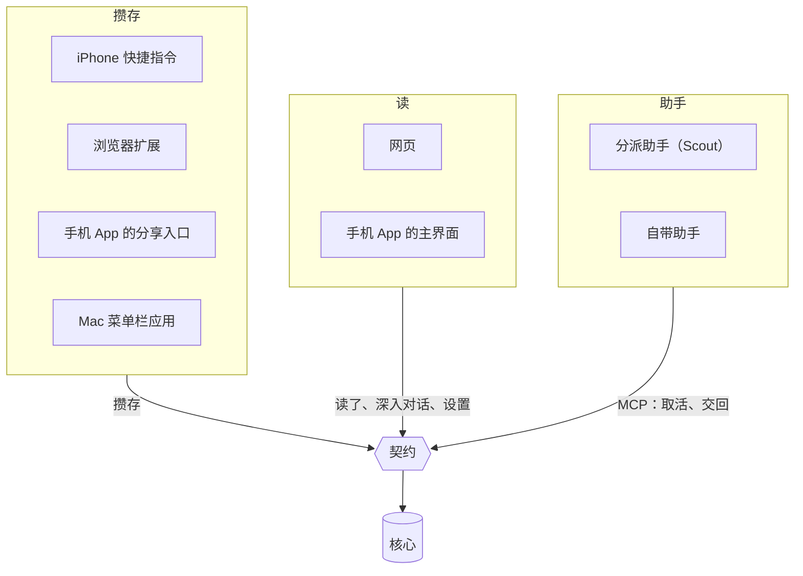

# 平台

所有平台只经契约和核心说话，互不知道对方存在。

## 三类角色

| 角色 | 能做什么 | 能看到什么 | 身份 |
|---|---|---|---|
| 攒存 | 攒一样东西，得到一句结果 | 什么都看不到 | 授权过的设备，只存入档 |
| 读 | 见下面的权限三档。看解读和每日摘要、标「读了」「不感兴趣」「看过了」、发起深入对话、进入深入对话的入口、看和下载笔记；管理档还能改助手设置、管理设备和助手 | 该用户的全部每日摘要和笔记、未删除的条目和解读 | 授权过的设备，读档或管理档 |
| 助手 | 见 [助手](assistants.md) | 干活需要的上下文 | 授权过的设备，只能做助手的事 |

攒存的契约只有两样：授权、保存。它定下后不再改动。

## 接入

对用户而言接入只有一个动作：在 本产品 的页面上点「允许」。界面上不出现凭据。背后两种做法：

| 谁 | 做法 | 用户看到 |
|---|---|---|
| 我们自己的客户端 | 短码：客户端发起请求，自报名称，显示一个短码 | 在一台管理档的设备上看到「某某想接入」和同一个短码，核对后点允许 |
| 助手 | OAuth：用户把接入地址填进助手那边，助手打开允许页 | 允许页：谁想接入、要干哪几步；起名字，点允许。见 [助手](assistants.md#接入和认证) |

- 短码 10 分钟有效，只能用一次。
- 每个接入的一方是一个设备，记：名称、种类（客户端 / 助手）、权限、接入时间、上次使用时间。名称用户可以改。
- 「助手设置」里的「设备」页列出全部设备，每行可改名、改档、撤销。允许、改档、撤销都需要管理档的设备。撤销立即生效，别的设备不受影响。
- 没有新建、查看、复制凭据的功能。能复制的只有三样，都不是凭据：接入地址、深入对话的开场话、月历的图片地址。

### 能接入的助手

| 产品 | 类 | 能做 | 在哪接 | 限制 |
|---|---|---|---|---|
| Claude | 对话型 | 深入对话 | 网页或桌面 | 各套餐可用，免费套餐一个连接器 |
| ChatGPT | 对话型 | 深入对话 | 只能在网页 | 个人套餐只能读：笔记由用户贴回。手机上不能用 |
| Gemini | 对话型 | 深入对话 | 只能在网页；接好后手机也能用 | 仅美国、18 岁以上、个人账号、英文 |
| Muse | 定时型 | 解读、汇总、深入对话 | 在它的对话里 | 能否走允许页待验证 |
| 自己部署的 agent | 定时型 | 解读、汇总、深入对话 | 它的配置里 | 要支持 MCP 和 OAuth |

「助手设置 → 接入一个助手」先选产品，再显示那个产品的分步指南，指南内容取自 [connect](connect.md)。

## 设备的权限

客户端分三档。授权时定下，之后可以在「设备」页改。

| 档 | 能做什么 | 缺省请求这一档的 |
|---|---|---|
| 只存入 | 攒存内容；看不到任何内容 | 快捷指令、浏览器扩展、分享入口、Mac 菜单栏应用 |
| 读 | 只存入的全部；读今天、每日摘要、笔记；深入对话、不感兴趣、看过了、读了；看状态栏 | 墨水屏、别人的或公用的设备上的网页 |
| 管理 | 读的全部；管理助手设置和规则；允许新设备接入；给设备改名、改档、撤销 | 手机 App、网页 |

- 授权页缺省选中对方请求的那一档。用户可以调低，不能调到比请求的高。
- 界面按权限裁剪：没有权限的入口不显示，不显示成点不动的样子。读档没有「助手设置」入口，状态栏只读；管理档点状态栏进助手设置。
- 只存入档的客户端没有读的界面，只有存入的反馈。
- [月历](form.md#月历)：读档和管理档的手机 App、网页有；只存入档和墨水屏没有。
- 至少有一台管理档的设备：最后一台管理档设备不能被降档或撤销。
- 用户的第一台设备由登录直接得到管理档，不经别的设备允许。
- 助手不用这三档，见 [助手](assistants.md#接入和认证)。

## 读的平台

入口见 [form](form.md#读的界面)。

| 页面 | 内容 |
|---|---|
| 今天 | 还没进每日摘要的解读和条目。关联提示在解读上。点开一个条目：原文、解读、标签，管理档可改「交给哪个助手」和「保留多久」 |
| 每日摘要 | 最新一份；按日期往前翻。没有搜索 |
| 笔记 | 深读队列：每条的精读状态、「看精读」「开始深入对话」，去过的那条上有「把结果贴回来」和「移出队列」；笔记按时间倒序，可查看、下载。没有搜索 |
| 助手设置 | 助手设置；设备：全部客户端和助手，可改名、改档、撤销；我的月历：图片地址的开关和样子 |

### 状态栏

每个主要页面常驻。内容：几只助手在干活、每只上次什么时候来、今天存入了几条、几条在等。三种版式：

| 版式 | 样子 | 用在 |
|---|---|---|
| 宽 | 一整条，每只助手一格 | 网页「今天」、平板 |
| 窄 | 标题栏里的一行字 | 网页其余页面、手机「今天」 |
| 最窄 | 一个小标识：助手的数量加一个状态点，点开展开成宽的 | 手机其余页面、Mac 菜单栏 |

### 通知

范围和规则见 [techspec](techspec.md#9-处理完成通知) §9 与 [rules](rules.md) A16：只推核心内置助手完成的解读或精读，推给读或管理档的设备，不推给助手；初筛完成不发通知。各端：

| 平台 | v1.0 能否收到 | 怎么收 | 什么时候问权限 |
|---|---|---|---|
| 网页 | 待 #53（按规则 v1.0 不发） | 浏览器推送（Web Push），每个浏览器各开一次；iPhone 上要先把网页加到主屏幕才收得到 | 用户在设置里点「通知我」之后，问一次 |
| iPhone App | 不能，v1.x | 系统推送（APNs），App 上线后启用 | 用户点「通知我」之后，系统问一次 |
| 安卓 App | 不能，v1.x | 系统推送（FCM），App 上线后启用 | 用户点「通知我」之后，系统问一次 |
| 扩展、分享入口、快捷指令、Mac 菜单栏应用 | 不推送 | 只存入的设备，看不到内容，不收推送 | — |
| 墨水屏 | 不推送 | 没有通知能力 | — |

## 核心

- 部署在公网，有 HTTPS 域名。
- 对外三组接口，都在同一份契约里：攒存、读、助手（MCP）。
- 另有一个公开的图片地址：用户打开后，返回他的[月历图](form.md#月历的图片地址)。不需要登录，只读，不含任何内容。
- 契约是手写的 OpenAPI 3.1，放在 `contract/`，是接口的唯一来源。各平台的类型和 MCP 工具清单从它生成。
- 改契约时在持续集成里自动比对新旧版本，并重放已发布客户端的请求样本。

## v1.0 的范围

| 平台 | 角色 | v1.0 |
|---|---|---|
| 核心 | — | 做 |
| 助手的接口（MCP） | 助手 | 做 |
| 分派助手（Scout） | 助手 | 做 |
| 网页 | 读 | 做 |
| iPhone 快捷指令 | 攒存 | 做 |
| 浏览器扩展 | 攒存 | 做 |
| iPhone App 和分享扩展 | 读 + 攒存 | 不做，v1.x |
| 安卓 App | 读 + 攒存 | 不做，v1.x |
| Mac 菜单栏应用 | 攒存 | 不做，v1.x |

通知在 v1.0 只有网页的浏览器通知；手机上的系统通知跟着手机 App 在 v1.x。另见 open #53：v1.0 核心内置助手只有分派助手，它不产生解读，按规则 v1.0 将不会发出任何通知。

v1.0 不包含：工作助手和计费、偏好说明、统计页、助手没来的提醒、再发布、公开注册。v1.0 只有 Cheney 一个用户。

顺序：契约 → 核心 → 助手的接口和分派助手 → 网页 → 攒存的客户端。

## 原型

AllKeep（`~/all-keep`，线上仍在运行）是功能和经验的参考，只读。

- 动 Mac 客户端前必读 `~/all-keep/docs/mac-app-pitfalls.md`；动快捷指令前必读 `~/all-keep/docs/ios-shortcut-pitfalls.md`。
- 不改原型的代码和线上服务；它由 AllKeep dev helper 维护。
- 不迁移它的内容和标签。
